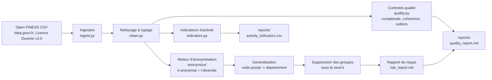

<!-- adam-badges:start -->
[](https://github.com/Adam-Blf/open-health-data-pipeline/commits)
[](https://hits.sh/github.com/Adam-Blf/open-health-data-pipeline/)
[](https://github.com/Adam-Blf/open-health-data-pipeline/commits)
[](https://github.com/Adam-Blf/open-health-data-pipeline)
[](LICENSE)
<!-- adam-badges:end -->

# Open Health Data Pipeline

Pipeline d'ingestion, controle qualite et anonymisation applique a un jeu de donnees de sante public francais (registre FINESS des etablissements sanitaires et sociaux). Le coeur technique du depot est un moteur generique de mesure du risque de reidentification (k-anonymat, l-diversite, generalisation, suppression), pense pour etre le meme moteur qu'on ferait tourner sur un extrait de donnees patient avant sa sortie d'un service d'information medicale, sans jamais manipuler la moindre donnee patient.

## Pourquoi ce depot

Ingenieur PMSI / Data Engineer en alternance au Departement d'Information Medicale (DIM) d'un groupement hospitalier, je manipule au quotidien des flux de donnees de sante soumis a une exigence forte d'anonymisation avant toute sortie de perimetre. Ce depot demontre cette competence sur donnees 100% publiques, sans toucher a aucun outil, format ou donnee de mon employeur.

## Cadre legal et perimetre des donnees, lu avant tout le reste

- **Source unique** : jeu de donnees ouvert **Open FINESS** (Fichier National des Etablissements Sanitaires et Sociaux), publie par l'Agence du Numerique en Sante (ANS) sur [data.gouv.fr](https://www.data.gouv.fr/datasets/open-finess). Fichier utilise : `finess-enrichi.csv`.
- **Licence** : [Licence Ouverte v2.0 (Etalab)](https://www.etalab.gouv.fr/licence-ouverte-open-licence/), reutilisation et redistribution libres sous reserve de mention de la source.
- **Nature des donnees** : niveau **etablissement** (hopitaux, cliniques, structures medico-sociales : raison sociale, categorie, adresse, capacite, equipements, activites autorisees). **Aucune donnee de patient, aucun dossier medical, aucune donnee individuelle de sante n'est presente dans ce jeu de donnees.**
- **Zero donnee de l'employeur** : aucun format ATIH, aucun fichier FICHSUP-PSY, aucune donnee ou code issus de la Fondation Vallee ou du GHT Sud Paris. Aucun doute possible sur la provenance : si une source n'etait pas clairement publique, elle n'a pas ete utilisee.
- **Jeux de test synthetiques** : les tests unitaires du moteur d'anonymisation (`tests/`) utilisent en complement de tres petits jeux de donnees **entierement fabriques** (voir `tests/conftest.py`), clairement documentes comme tels, pour prouver le comportement du moteur sur des cas limites (groupe unique, groupe homogene) qu'un vrai jeu de donnees ne contient pas forcement.

## Pourquoi le k-anonymat compte pour la donnee de sante

Une donnee de sante rarement croisee avec peu d'autres attributs redevient identifiante : un etablissement unique dans un code postal donne pour une categorie donnee est reidentifiable trivialement par quiconque connait deja ces deux attributs (exactement le risque qu'on retrouve, a l'echelle patient, avec une combinaison age + sexe + commune + pathologie rare). Le k-anonymat impose qu'aucune combinaison de quasi-identifiants ne soit partagee par moins de `k` lignes ; la l-diversite complete ce controle contre l'attaque par homogeneite (un groupe peut respecter k-anonymat tout en revelant a coup sur un attribut sensible si toutes ses lignes partagent la meme valeur). Le module `health_pipeline.anonymize` implemente les deux, plus la generalisation (code postal -> departement) et la suppression des groupes residuels sous le seuil, avec un rapport de risque avant/apres genere automatiquement.

## Architecture



## Installation

```bash
python -m venv .venv
source .venv/Scripts/activate   # Windows Git Bash
pip install -e ".[dev]"
```

## Utilisation

```bash
# 1. Telecharger le jeu de donnees reel (facultatif, un echantillon reel est deja fourni)
python scripts/download_data.py

# 2. Executer le pipeline complet sur l'echantillon commite
python -m health_pipeline.pipeline --input data/sample/finess_sample.csv --output reports/

# 3. Executer sur le jeu de donnees complet telecharge
python -m health_pipeline.pipeline --input data/raw/finess-enrichi.csv --output reports/
```

Sorties generees dans `reports/` : `quality_report.md`, `risk_report.md`, `activity_indicators.csv`.

## Tests

```bash
pytest -q
ruff check .
```

Le moteur d'anonymisation est developpe en TDD : chaque regle (taille de classe d'equivalence, generalisation, suppression, l-diversite) a son test avant toute evolution, car c'est la logique metier critique du depot.

## Structure

```
src/health_pipeline/
  ingest.py          ingestion du CSV FINESS reel
  clean.py            typage, nettoyage, derivation departement
  quality.py           completude, coherence, outliers (IQR)
  anonymize/
    k_anonymity.py     detection quasi-identifiants, k-anonymat, generalisation, suppression
    l_diversity.py      l-diversite (attaque par homogeneite)
    risk_report.py      rapport de risque avant/apres, rendu markdown
  indicators.py        indicateurs d'activite hospitaliere par departement
  pipeline.py          orchestration bout en bout + CLI
tests/                  pytest, TDD sur le moteur d'anonymisation
scripts/                telechargement des donnees, execution du pipeline
data/sample/            echantillon reel commite (reproductibilite CI)
data/raw/               donnees brutes telechargees (gitignore)
docs/ARCHITECTURE.md    detail d'architecture
```

## Preuve chiffree sur le jeu de donnees complet reel

Mesure de reference (102623 etablissements, `finess-enrichi.csv` telecharge en entier, voir `docs/reference_full_dataset_risk_report.md` pour la reproduire) :

| Etape | min k | % lignes sous le seuil k=5 |
|---|---|---|
| Avant anonymisation (code postal + categorie) | 1 | 74.33% |
| Apres generalisation (departement + categorie) | 1 | 9.61% |
| Apres generalisation + suppression des groupes residuels | 5 | 0% (9863 lignes soit 9.61% supprimees) |

Point important, delibere : la l-diversite echoue sur le jeu publie (min l=1, 3573/3758 groupes homogenes sur l'attribut `psychiatrie`). C'est exactement l'interet pedagogique du depot : un jeu peut satisfaire le k-anonymat et rester attaquable par homogeneite (voir la section "Verdict" du rapport). Un vrai projet de diffusion doit verifier les deux, jamais un seul.

## Limites connues

- La derivation departement a partir du code postal est une approximation (2 premiers chiffres, 3 pour l'outre-mer), pas une jointure officielle INSEE.
- Le seuil k=5 et le seuil l=2 sont des valeurs pedagogiques standards, pas une recommandation reglementaire pour un cas d'usage donne : un vrai projet de diffusion choisit ses seuils avec un DPO.
- La suppression des groupes residuels reduit la completude du jeu publie (9.61% des lignes sur le jeu FINESS complet) : compromis assume et documente, jamais cache.
- L'echantillon commite dans `data/sample/` (2000 lignes) est plus epars que la population complete (propriete statistique attendue d'un sous-echantillon aleatoire) : ses propres chiffres de risque different de la mesure de reference ci-dessus, voir `data/sample/README.md`.

## Licence

Code sous licence MIT (voir `LICENSE`). Donnees sous Licence Ouverte v2.0 (Etalab), source citee ci-dessus.
