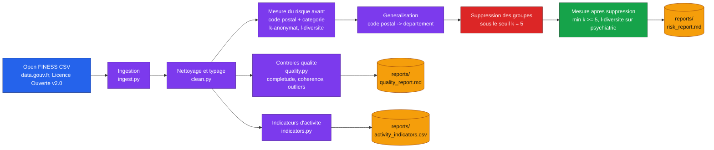

# Architecture

## Vue d'ensemble

## Decisions d'architecture

### Pourquoi FINESS et pas un jeu de donnees patient

Aucune donnee patient francaise n'est publiable en open data (raison meme de
l'anonymisation). FINESS est le seul niveau de granularite reel, public et
documente qui reproduit la structure exacte d'un risque de reidentification
(identifiant geographique + attribut categoriel + attribut numerique) sans
qu'aucune personne physique ne soit concernee : c'est un registre
d'etablissements, pas de patients. Le moteur d'anonymisation est ecrit de
maniere generique (n'importe quelle liste de colonnes en quasi-identifiants,
n'importe quelle colonne sensible) pour etre le meme code qui tournerait sur
un extrait patient reel dans un contexte hospitalier, sans qu'aucun tel
extrait ne soit jamais present dans ce depot.

### Pourquoi generalisation puis suppression, et pas l'un ou l'autre seul

La generalisation seule (code postal -> departement) reduit le risque mais
ne suffit pas toujours : certaines combinaisons departement + categorie
restent rares. La suppression des groupes residuels sous le seuil `k` est la
technique standard pour fermer ce residu, au prix d'une perte de completude
qui est mesuree et rapportee explicitement plutot que masquee.

### Pourquoi psychiatrie comme colonne sensible pour la l-diversite

Le drapeau d'activite `psychiatrie` (l'etablissement propose ou non une
activite de psychiatrie) est utilise comme colonne sensible de demonstration
car il illustre, sur donnee publique d'etablissement, le meme type
d'attribut sensible qu'une pathologie le serait sur une donnee patient,
sans jamais reveler d'information sur une personne reelle : c'est un
attribut institutionnel deja publie par l'ANS.

### Pourquoi pas de notebook Jupyter pour les indicateurs

Le calcul des indicateurs d'activite est un module Python teste
(`indicators.py`) plutot qu'un notebook, pour rester executable et testable
en CI sans dependance a un kernel Jupyter. Le rapport `activity_indicators.csv`
genere par le pipeline est le livrable consultable.

## Limites documentees

Voir la section "Limites connues" du README.
